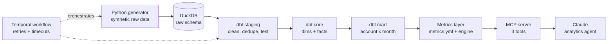
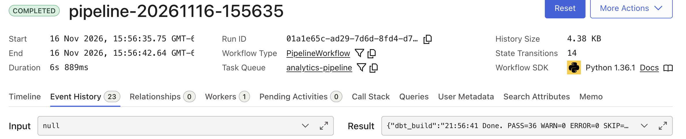
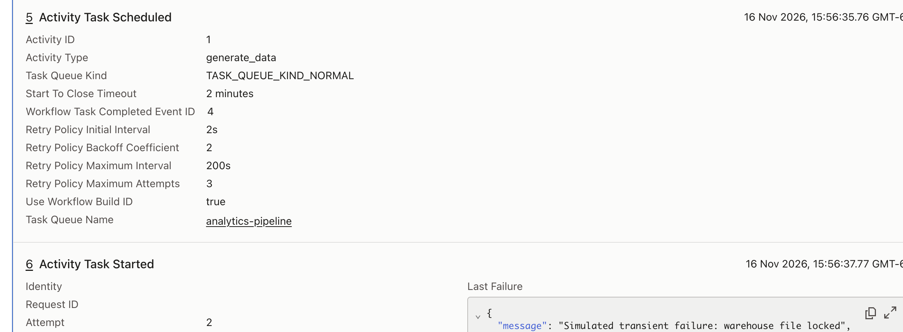
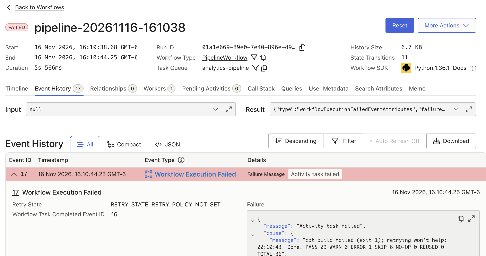

# dbt Governed Metrics Agent

An end-to-end, production-grade analytics system: tested dbt models and governed metrics that power an AI agent answering business questions in plain English.

The agent answers **only** through approved metric definitions. It never writes raw SQL.

**Under the hood:** raw data → dbt models → governed metrics layer → MCP server → AI agent. The pipeline is orchestrated by Temporal, and the agent is measured with an eval set (19/19).


**Results:** 19/19 on the eval set after one round of fixes (see [Evals](#evals)). The pipeline is orchestrated by Temporal, which retries transient failures and stops immediately on failed data tests (see [Orchestration](#orchestration-with-temporal)).

---

## Why this exists

Business teams want to ask data questions in plain English. This project shows a safer pattern:

1. **Model the data carefully** in dbt, with explicit grain and tests at every layer.
2. **Define each metric once** in a governed metrics layer.
3. **Give the agent tools, not SQL access**, so every number traces back to an approved definition.
4. **Measure the agent** with an eval set and fix what it gets wrong.

## Architecture



## The data

Synthetic data for a fictional cloud platform, with pricing loosely shaped like real usage-based developer platforms: a monthly plan fee plus charges per million **actions** (billable units of work) and per GB of storage.

- Built-in patterns for the metrics to find: regions growing at different rates, a few large customers driving most usage, expansion, churn, plan upgrades and downgrades, weekday seasonality
- Built-in mess for staging to fix

The generator uses a fixed random seed, so every run produces identical data and the eval answers never change.

## Data model

| Layer | Model | Grain | Notes |
| --- | --- | --- | --- |
| Staging | `stg_accounts`, `stg_namespaces`, `stg_plan_changes`, `stg_daily_usage`, `stg_invoices` | One row per source record | Trim, cast, standardize categories, remove exact duplicates |
| Core | `dim_account_plan_history` | One row per account per plan period | Type 2 slowly changing dimension (`valid_from`, `valid_to`, `is_current`) |
| Core | `dim_accounts` | One row per account | Signup plan **and** current plan, which differ for accounts that changed plans |
| Core | `fct_daily_usage` | One row per namespace per day | Usage linked to accounts |
| Mart | `mart_account_monthly` | One row per account per month | Revenue, billed plan, actions, active namespaces, storage |

**Tests on every layer:** `unique`, `not_null`, `accepted_values` and `relationships`, plus singular tests that enforce each model's grain, including composite keys. The mart is checked against invoice totals to catch fan-out.

## Metrics layer

Every metric is defined once in [`metrics/metrics.yml`](metrics/metrics.yml):

| Metric | Definition |
| --- | --- |
| `revenue` | Total invoiced revenue |
| `billable_actions` | Total actions run on the platform |
| `active_accounts` | Distinct accounts with an invoice in the period |
| `active_namespaces` | Namespaces with at least one action in the month |
| `revenue_per_active_account` | Revenue ÷ active accounts |
| `avg_storage_gb` | Average storage per account (averaged, never summed) |
| `new_accounts` | Accounts whose signup month falls in the period |

**Dimensions:** `plan`, `region`, `signup_month`, `account_id`. **Time grains:** month, quarter, year, or a single total.

[`metrics/metrics.py`](metrics/metrics.py) turns a request like *revenue by region by quarter for 2026* into SQL. 

## The agent

[`agent/server.py`](agent/server.py) is an MCP server exposing three tools:

| Tool | Purpose |
| --- | --- |
| `list_metrics` | What can be asked |
| `describe_metric` | The exact definition, so the agent can explain its answer |
| `query_metric` | The only way to get numbers |

Every result row includes a readable `display` value (`11.3B`, `$245.3K`), and the server gives the agent answering rules: state the period, state comparison periods for growth, flag growth from tiny bases, and label anything inferred.

## Evals

[`agent/evals.yml`](agent/evals.yml) holds 19 questions across five categories: lookups, breakdowns, trends, ambiguous questions and out-of-scope questions.

| Run | Result | What changed |
| --- | --- | --- |
| 1 | 16 pass, 2 partial, 1 fail | Baseline |
| 2 | 19/19 (the 3 non-passing questions rerun, plus a regression check) | Readable display values, answering rules, caveats in metric descriptions |

**What run 1 found:**
- **Unreadable numbers** (`11331482576`). Fixed with deterministic formatting in the tool response rather than a prompt instruction
- **Unstated periods.** "Typical storage" was averaged over all 18 months without saying so.
- **Inference presented as fact.** Asked about plan changes (not a metric), it inferred an answer from billed plans without saying it was an inference.

**A lesson about evals themselves:** two of the first-pass "fails" were correct answers to a different, valid reading of the question. Good ground truth accepts every valid interpretation and grades whether the agent stated its choice.

## Orchestration with Temporal

The pipeline (generate data → `dbt build` → metrics tests) runs as a [Temporal](https://temporal.io) workflow. Each step is an activity with its own timeout and retry policy (up to 3 attempts, backing off 2s then 4s).



**Not every failure should be retried.** Each activity maps exit codes to a decision:

| Failure | What happens | Why |
| --- | --- | --- |
| Transient: a crash, a locked database file | Retried with backoff | The step is idempotent (fixed seed, `create or replace`), so rerunning is safe and likely to work |
| Permanent: a failed dbt test (exit 1) | Fails immediately, no retries | The data is wrong; rerunning gives the same answer and delays the alert |

**A transient failure, retried.** Setting `PIPELINE_FLAKY=1` makes the first `generate_data` attempt fail. Temporal retried 2 seconds later, and attempt 2 succeeded:



**A permanent failure, stopped.** With duplicate invoices let through, the `unique` test fails and the workflow stops after one attempt. Downstream models are skipped, and the metrics tests never run on bad data:



The workflow code only orchestrates (order, timeouts, retries). All file and database work happens in activities, which keeps the workflow deterministic so Temporal can replay it.


## Design decisions

- **DuckDB:** free, local and zero setup
- **A lightweight metrics layer instead of MetricFlow:** MetricFlow wouldn't install cleanly alongside the current dbt version, so I built a small engine with the same concepts (metrics, dimensions, time grains). 
- **Dimensions are a deliberate choice:** `account_id` is exposed so the agent can answer top-customer questions. In a setting where customer-level data is sensitive, it would be left out.
- **Deterministic code over prompting** wherever possible: formatting, validation and limits live in code; prompts handle judgment.

## Quickstart

```bash
git clone https://github.com/mahakkoli/cloud-usage-analytics.git
cd cloud-usage-analytics
python -m venv .venv && source .venv/bin/activate
pip install -r requirements.txt

python generator/generate_data.py   # creates warehouse.duckdb
dbt build                           # builds and tests every model
python -m pytest -q metrics/        # tests the metrics layer
```

**Connect the agent** (Claude Code):

```bash
claude mcp add cloud-usage-metrics --scope project -- "$PWD/.venv/bin/python" "$PWD/agent/server.py"
```

Then start Claude in the project and ask: *"Answer only using the cloud-usage-metrics tools. Which plan drives the most revenue?"*

## Project structure

```
cloud-usage-analytics/
├── generator/        synthetic data generator
├── models/
│   ├── staging/      one model per raw table
│   ├── core/         dimensions and facts
│   └── marts/        account x month mart
├── tests/            singular grain tests
├── metrics/          metric definitions, engine, tests
├── agent/            MCP server and eval set
├── orchestration/    Temporal workflow, activities, worker
└── docs/images/      screenshots used in this README
```

## Roadmap

- Warn the agent when results are truncated at the row cap
- Derived metrics (defining a metric from other metrics by name) and net revenue retention
- Run the pipeline nightly with a Temporal Schedule
- Test the workflow in CI with Temporal's test environment
